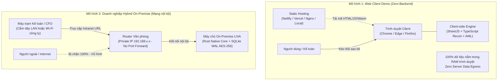
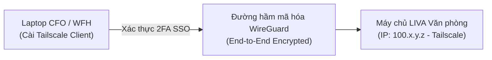

# Triển khai Web Client & Cô lập Mạng Nội bộ

> **Tài liệu hướng dẫn vận hành chuẩn**: Quy chuẩn hóa hai mô hình triển khai: **Bản Web Demo Độc lập (Zero-Backend)** phục vụ trình diễn, đánh giá giao diện và kiểm thử đối soát; song song với **Kiến trúc Cô lập Mạng Nội bộ (Intranet / Private LAN / Mesh VPN)** tuân thủ Nghị định 13/2023/NĐ-CP và Thông tư 09/2020/TT-NHNN.

[⬆ Mục lục](../README.md) · [◀ Triển khai và runtime](03-trien-khai-va-runtime.md) · [Sao lưu và phục hồi SQLite ▶](06-backup-restore-sqlite.md)

---

## 1. Tổng quan Hai Mô hình Vận hành

Hệ thống LIVA Banking được thiết kế theo cấu trúc module hóa cao, cung cấp hai hình thái triển khai độc lập tùy theo nhu cầu:



| Tiêu chí | Mô hình 1: Web Demo Độc lập | Mô hình 2: Doanh nghiệp On-Premise |
|---|---|---|
| **Mục đích** | Trình diễn, đánh giá UI/UX, thử nghiệm thuật toán | Vận hành kế toán, quản lý quỹ và phê duyệt lệnh thật |
| **Yêu cầu Server** | **Không cần server backend** (Chỉ cần hosting file tĩnh) | Server nội bộ chạy Rust Native Core + SQLite WAL |
| **Xử lý Dữ liệu** | 100% trong RAM trình duyệt qua TypeScript/SheetJS | Rust Streaming Deserialization & SIMD AHash Engine |
| **Lưu trữ** | In-Memory (mất khi đóng tab trình duyệt) | Bền vững trên đĩa, mã hóa AES-256-GCM niêm phong DPAPI |
| **Tuân thủ Pháp lý**| Zero Data Egress (dữ liệu không rời máy client) | Đạt chuẩn NĐ 13/2023, TT 09/2020 Maker-Checker 2 pha |

---

## 2. Hướng dẫn Triển khai Web Demo (Client-Only)

Bản Web Demo (`teamwork_projects/liva_banking_universal/dist` hoặc tệp nén `LIVA_Banking_Web_Demo.zip`) đã được biên dịch hoàn chỉnh thành mã tĩnh HTML5, CSS và JavaScript hiện đại.

### 2.1. Cách 1: Kéo thả Netlify Drop (Có URL Web sau 30 giây)
Đây là cách nhanh nhất để tạo một URL chia sẻ cho đối tác hoặc trình chiếu:
1. Mở trình duyệt và truy cập: `https://app.netlify.com/drop`
2. Kéo thả thư mục `dist`:
   `teamwork_projects/liva_banking_universal/dist`
   *(hoặc giải nén tệp `LIVA_Banking_Web_Demo.zip` và kéo thư mục đó vào).*
3. Hệ thống sẽ cấp một tên miền HTTPS ngẫu nhiên (ví dụ: `https://liva-banking-treasury.netlify.app`) sẵn sàng sử dụng.

### 2.2. Cách 2: Triển khai lên Vercel (CLI)
Thư mục dự án đã có sẵn cấu hình bảo mật `vercel.json`:
```powershell
cd teamwork_projects/liva_banking_universal
npx vercel --prod
```

### 2.3. Cách 3: Chạy máy chủ tĩnh nội bộ (Local Static Server)
Để kiểm tra trên máy trạm hoặc trình chiếu offline không cần Internet:
```powershell
# Sử dụng npx serve
npx serve teamwork_projects/liva_banking_universal/dist -l 5000

# Hoặc sử dụng Vite preview
cd teamwork_projects/liva_banking_universal
npm run preview
```
Mở trình duyệt truy cập: `http://localhost:5000` (hoặc cổng được chỉ định).

### 2.4. Cách 4: Triển khai Nginx On-Premise
Nếu doanh nghiệp muốn đưa bản web demo lên máy chủ web tĩnh nội bộ:
```nginx
server {
    listen 80;
    server_name liva-demo.company.local;

    root /var/www/liva-banking/dist;
    index index.html;

    # Cấu hình Single Page Application (SPA)
    location / {
        try_files $uri $uri/ /index.html;
    }

    # Bổ sung header bảo mật chống clickjacking & sniffing
    add_header X-Frame-Options "DENY" always;
    add_header X-Content-Type-Options "nosniff" always;
    add_header Content-Security-Policy "default-src 'self' 'unsafe-inline' 'unsafe-eval' data: blob:;" always;
}
```

---

## 3. Kiểm soát Truy cập & Cô lập Mạng Nội bộ (Intranet Access Control)

Đối với các tổ chức tài chính và doanh nghiệp lớn, việc ngăn chặn truy cập ngoài luồng từ Internet là bắt buộc theo quy định của Ngân hàng Nhà nước. Dưới đây là 3 phương án bảo vệ từ mức cơ sở đến nâng cao.

### 3.1. Phương án 1: Triển khai Mạng LAN Nội bộ thuần túy *(Khuyến nghị)*
Phương án này đảm bảo an toàn vật lý tuyệt đối: chỉ thiết bị kết nối vào mạng nội bộ của văn phòng mới thấy được dịch vụ.

1. **Gán IP Cố định cho Máy chủ / Trạm phát:**
   - Đặt IP tĩnh nội bộ cho máy chủ trong mạng LAN (ví dụ: `192.168.1.50`).
2. **Khởi chạy ứng dụng lắng nghe card mạng nội bộ:**
   ```powershell
   # Lắng nghe toàn bộ card mạng nội bộ trên cổng 5000
   npx serve teamwork_projects/liva_banking_universal/dist -l 5000 --host 0.0.0.0
   ```
3. **Cấu hình Router Văn phòng:**
   - **Tuyệt đối không bật Port Forwarding / Virtual Server / DMZ** trỏ tới cổng 5000.
   - Khi đó, mạng Internet bên ngoài hoàn toàn không có đường định tuyến tới máy chủ.
4. **Phân quyền truy cập:**
   - Nhân viên văn phòng kết nối vào Wi-Fi công ty hoặc cắm dây LAN: Mở trình duyệt gõ `http://192.168.1.50:5000` là vào được ngay.
   - Ngay khi rời khỏi văn phòng hoặc ngắt Wi-Fi, kết nối lập tức bị gián đoạn.

### 3.2. Phương án 2: Mạng Riêng Ảo Mesh VPN (Tailscale / WireGuard)
Dành cho trường hợp CFO, Kế toán trưởng hoặc Lãnh đạo cần truy cập an toàn khi đi công tác hoặc làm việc từ xa (WFH) mà không mở port ra Internet:



1. Cài đặt **Tailscale** trên máy chủ văn phòng và máy của nhân viên được cấp quyền.
2. Máy chủ nhận một địa chỉ IP ảo cố định (dải `100.x.y.z`).
3. Ứng dụng LIVA lắng nghe trên IP Tailscale này.
4. Chỉ những máy tính thuộc cùng mạng Tailscale của công ty và đã xác thực 2FA/SSO mới có thể kết nối vào hệ thống.

### 3.3. Phương án 3: Tường lửa Lọc IP (IP Whitelist) & Cloudflare Zero Trust
Dành cho trường hợp doanh nghiệp muốn đặt bản web trên hạ tầng Cloud (Vercel / AWS / VPS) nhưng chỉ cho phép văn phòng truy cập:

1. **Lấy IP Tĩnh của Văn phòng:**
   - Kiểm tra IP Public của đường truyền Internet văn phòng do nhà mạng cấp (ví dụ: `113.161.x.x`).
2. **Thiết lập Tường lửa / Reverse Proxy:**
   - Trong Nginx hoặc Cloudflare WAF: Tạo quy tắc chỉ `ALLOW` dải IP `113.161.x.x`, tất cả các IP khác đều bị chặn với mã lỗi `403 Forbidden`.
3. **Cloudflare Access (Zero Trust):**
   - Định tuyến qua `cloudflared` tunnel.
   - Thiết lập chính sách bảo vệ: Bắt buộc đăng nhập bằng email công ty (`@company.com`) và xác thực OTP trước khi cho phép vào giao diện LIVA.

---

## 4. Kịch bản Thuyết trình Nhanh (Presenter Cheat-Sheet)

Dành cho Người trình bày / Trưởng nhóm kỹ thuật tự tin trả lời hội đồng thẩm định, ban giám khảo hoặc đối tác ngân hàng trong 30 giây:

> **Hội đồng hỏi:** *"Hệ thống này chỉ cần client web là chạy được à? Nếu chạy web thì dữ liệu sao kê của ngân hàng có bị đẩy lên máy chủ đám mây không?"*
>
> **Trả lời:**
> *"Dạ thưa Ban giám khảo, LIVA được kiến trúc theo nguyên lý **Zero-Backend Client-Side Execution**:
> 1. **Toàn bộ logic bóc tách sao kê và đối soát 3 tầng chạy 100% bên trong RAM trình duyệt của người dùng** bằng TypeScript và thuật toán số học xác định. Khi người dùng kéo thả file sao kê, không có bất kỳ byte dữ liệu nào bị truyền ra Internet.
> 2. **Đối với môi trường vận hành thực tế**, hệ thống vận hành theo mô hình **On-Premise Intranet**: Web server chỉ lắng nghe trong dải mạng LAN nội bộ của công ty. Chỉ những máy tính cắm dây mạng hoặc kết nối đúng Wi-Fi văn phòng mới mở được; bên ngoài Internet hoàn toàn không thể dò thấy, đảm bảo tuân thủ 100% Nghị định 13/2023/NĐ-CP và Thông tư 09/2020/TT-NHNN."*

---

## 5. Danh mục Kiểm tra Sẵn sàng Triển khai (Checklist)

- [ ] File `teamwork_projects/liva_banking_universal/dist/index.html` tồn tại và đầy đủ assets.
- [ ] Đã kiểm tra mở thử nghiệm ngoại tuyến bằng trình duyệt (Offline Verification).
- [ ] Đã xác nhận cổng nội bộ (5000 hoặc 8002) không bị lộ ra ngoài Internet qua NAT/Port-Forwarding.
- [ ] Đã chuẩn bị sẵn các tệp sao kê mẫu (VCB, TCB, BIDV) trong thư mục `public/data/` để trình diễn tức thì.
